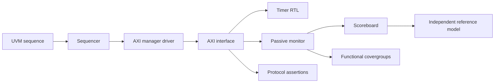

# Design and verification architecture

`rtl/axi4lite_timer_pkg.sv` defines the required register/field encodings and
byte merge helper. `rtl/axi4lite_timer.sv` implements two independent one-entry
write buffers, one outstanding B response, one outstanding R response and a
captured-period one-shot timer. See RTL_BEHAVIOR.md for exact timing priorities.

The driver contains no register decoder or expected read values. It launches
AW and W independently, can overlap read/write directions, holds payloads until
handshake, inserts response backpressure and deliberately cancels transactions
by reset in the robustness sequence.

The passive monitor reconstructs writes using accepted AW/W payloads and edge
timestamps. It observes accepted AR/B/R events before clocked DUT updates and
samples settled READY/response/IRQ outputs 1 ps later. Observations are new
objects, never reused after publication to analysis subscribers.

The scoreboard's expectations come from its own model of accepted requests.
COUNT is computed from elapsed edge numbers and the captured period instead
of copying the DUT's incrementing counter. The model has no DUT internal-net
access and does not call the RTL merge helper. Reads latch pre-edge expected
data. The scoreboard checks availability and payload each edge, accepted
responses at consumption, capacity-derived READY, IRQ, cancellation and totals.

Covergroups sample actual observed traffic: read/write address classes, all
strobe masks, accepted AW/W ordering, response classes, all channel stalls,
reset in flight, DONE observations and IRQ transitions. Percentages come from
simulator covergroup methods. Separate named hit counters expose every planned
bin, including zero-hit bins, for reproducible merging and exclusions.

The RTL-only bench remains independent of UVM and provides focused timing and
collision checks. The explicit testbench RDATA fault control validates the UVM
scoreboard; it is kept separate from actual RTL mutations used for bug finding.
Generated objects and shared timer simulator binaries remain in build/uvm/obj;
each test/seed has separate logs, verdict, coverage data and trace.
